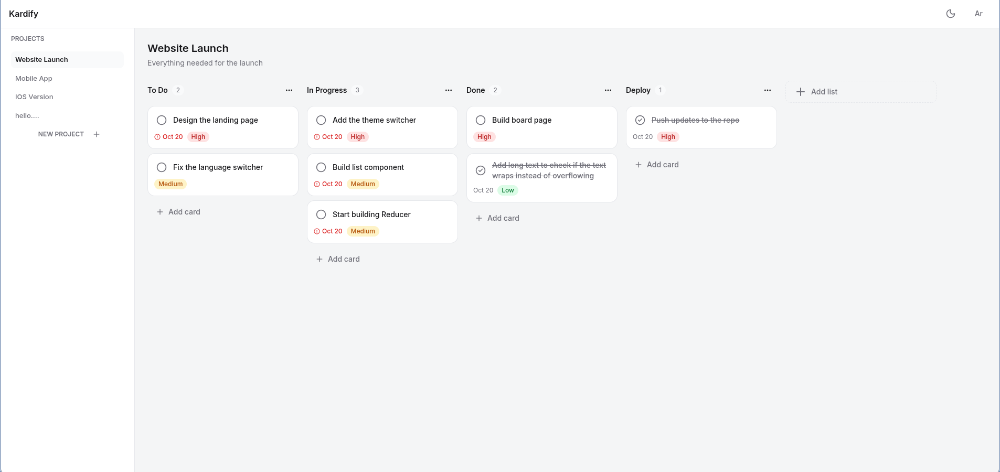
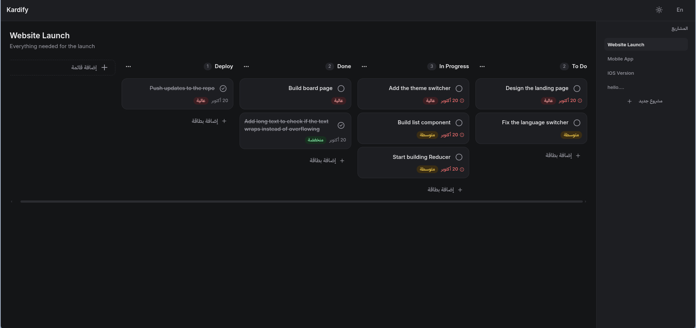

# Kardify

A kanban board for organizing work into projects, lists and cards. Fully bilingual (English and Arabic with real right-to-left layout), light and dark themes, drag and drop, and everything saved in the browser.

**Live demo:** https://kardify.vercel.app

**Light mode:**

**Dark mode:**


## Features

- **Projects:** create, edit and delete projects. Deleting a project also removes its lists and cards.
- **Lists:** add, rename and delete lists, with a confirmation that tells you how many cards will be lost.
- **Cards:** title, description, priority (low, medium, high) and an optional due date. Add, edit, delete and mark as complete.
- **Drag and drop:** reorder cards inside a list or move them between lists, including into an empty list. Press Escape to cancel a drag.
- **Card drawer:** click a card to open a details view with an edit mode. The open card lives in the URL (`?card=<id>`), so a refresh or the back button behaves the way you expect.
- **Validation:** required titles, and due dates can't be set in the past (an already overdue card can still be edited).
- **Due-date states:** overdue and due-soon cards are highlighted, with an icon and screen-reader text, not just color.
- **English and Arabic:** the whole interface is translated, the layout flips for right-to-left, and plural forms follow each language's rules.
- **Light and dark themes:** the choice is remembered, and the first visit follows the system setting.
- **Responsive:** works from phone width up. The sidebar becomes a slide-in menu on small screens.
- **Persistence:** all data is saved to `localStorage` and restored on load, with a safe fallback if the saved data is missing or corrupted.
- **Empty states** for no projects, no lists and no cards.

## Tech stack

| Area          | Choice                                                             |
| ------------- | ------------------------------------------------------------------ |
| Framework     | React 19 + TypeScript, built with Vite                             |
| Styling       | Tailwind CSS v4 with semantic color tokens (light and dark values) |
| Components    | shadcn/ui (Radix primitives) for dialogs, the drawer and menus     |
| State         | Redux Toolkit (three slices, flat normalized data)                 |
| Routing       | React Router                                                       |
| Drag and drop | dnd-kit (`@dnd-kit/react`)                                         |
| i18n          | i18next + react-i18next, browser language detection                |
| Deployment    | Vercel                                                             |

## Design decisions worth a look

- **Flat state with cascades.** Projects, lists and cards are three flat arrays linked by `projectId` and `listId`. Deleting a list removes its cards through `extraReducers`, and deleting a project goes through a thunk that deletes each list first.
- **`order` is the reducer's job.** Forms send only what the user typed. The reducer computes the next `order` (highest plus one, so it never collides after a deletion), while ids and timestamps are created by the caller so reducers stay pure.
- **`moveCard` is a pure function.** It takes the cards, the card id, the destination list and the final index, and returns the cards with `listId` and `order` renumbered for both affected lists. The reducer just calls it.
- **Dragging uses a temporary draft.** While a drag is in progress, the board renders from a draft of card ids per list, and a single `moveCard` is dispatched on drop. That keeps React and dnd-kit in agreement about the DOM, and means the store (and the `localStorage` save) updates once per drop, not on every hover.
- **RTL from the start.** Layout uses logical Tailwind classes (`ms-`, `pe-`, `start-`, `text-start`) instead of left and right, so Arabic needs no separate stylesheet. `dir` and `lang` are set in one place when the language changes.
- **Dates as plain strings.** Due dates are `YYYY-MM-DD` strings compared as text in local time, which avoids the off-by-one-day bugs that come from UTC parsing.
- **UI state in the URL.** The open card is a search param, so no callbacks are passed down through the list components.

## Getting started

You need a recent LTS version of Node.js.

```bash
git clone https://github.com/<your-username>/<repo-name>.git
cd <repo-name>
npm install
npm run dev
```

Other scripts:

```bash
npm run build     # type-check and build for production
npm run preview   # serve the production build locally
npm run lint      # run ESLint
```

## Project structure

```
src/
  components/
    ui/          shadcn/ui components and a few shared primitives
    board/       lists, cards, card form, drawer, list and card dialogs
    projects/    project card, form and dialogs
    layout/      header, sidebar, layouts
    common/      shared pieces such as the not-found state
  pages/         Home, Projects, Board, NotFound
  store/         Redux slices, thunks, hooks and localStorage persistence
  locales/       en and ar translation files, split by page
  utils/         pure helpers (moveCard, date helpers, formatting)
  types/         shared TypeScript types
```

## Known limitations

- Data is stored per browser, so projects created on one device don't appear on another.
- There is no search or filtering yet.
- There are no automated tests yet.

## What I'd add next

- **Search and filters:** title search, a priority filter and "hide completed", kept in the URL.
- **Tests:** unit tests for `moveCard` and the reducers (renumbering, cascade deletes), then component tests for the forms.
- **Animations:** cards animating into place and fading out on delete, once the drag and drop behavior is fully settled.
- **List reordering** by drag and drop.
- **Accounts and cloud sync** (Supabase), so data follows the user between devices.
